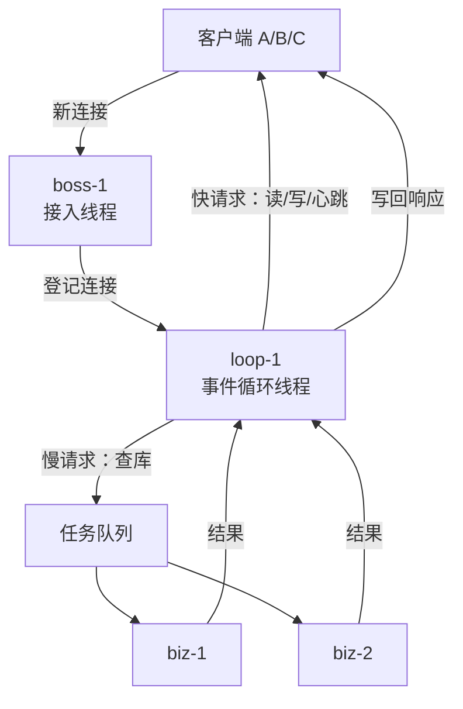
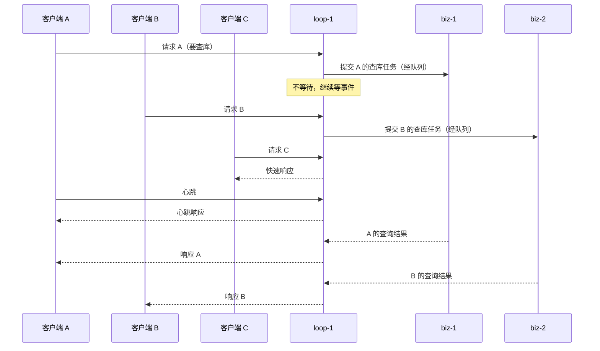

# 阶段 4 讲义：并发模式与高层抽象

> 对应学习路线：阶段 4
> 目标：从"写对"走向"好用、易维护"：能按场景选型，能设计有界、可关闭、可观测的线程池，能用消息传递和不可变状态收敛并发边界。
> 前置：阶段 2（锁、条件变量、有界阻塞队列、100 行线程池）、阶段 3（happens-before、安全发布、volatile/atomic）。
> 示例以 Java 为主；C++/Go/Rust 的对应物在文中标注。

## 本讲地图

1. 这一阶段在解决什么
2. 任务抽象：Thread、Future、Promise
3. CompletableFuture 与 async/await
4. 结构化并发与虚拟线程
5. 线程池：七个参数与执行顺序
6. 线程数与队列容量怎么定
7. 拒绝策略、隔离、关闭与可观测性
8. 并发数据结构：ConcurrentHashMap、跳表、COW、LongAdder
9. 并发数据结构：无锁队列与组合陷阱
10. 并发模式：生产者-消费者与 work stealing
11. 并发模式：reactor 与 event loop
12. 共享内存之外：actor 与 CSP/channel
13. 顺序、幂等与单一写者
14. 选型与设计原则
15. 四个必做实验
16. 常见误区
17. 自测四问
18. 小结

---

## 1. 这一阶段在解决什么

阶段 0–3 解决的是"正确性"：

- 知道并发 bug 从哪来（阶段 0–1）。
- 会用锁、条件变量、原子类把同步补上（阶段 2）。
- 理解 happens-before，能解释可见性和有序性（阶段 3）。

但"正确"不等于"好用"。工程里更常见的事故不是"锁写错了"，而是：

- 每个请求 new 一个线程，流量一上来就 OOM。
- 线程池用了无界队列，故障时任务堆到内存爆掉。
- 所有业务共用一个池，一个慢下游拖垮全站。
- 用 `CompletableFuture` 编排了一堆回调，异常丢了、超时没设、线程池没隔离。
- 状态被多个线程改，锁越加越多，没人说得清哪把锁保护什么。

阶段 4 的主线是三条：

| 主线     | 要回答的问题                               | 产出                                      |
| -------- | ------------------------------------------ | ----------------------------------------- |
| 任务抽象 | 任务怎么表达、怎么组合、怎么取消、怎么等   | Future/Promise、async/await、结构化并发   |
| 执行资源 | 任务在哪跑、跑多少、排队多久、满了怎么办   | 线程池、队列、拒绝策略、隔离              |
| 状态边界 | 状态归谁、怎么共享、怎么传递、怎么保证顺序 | 并发容器、不可变快照、actor/CSP、单一写者 |

一句话：**阶段 2–3 是在共享内存模型里把锁用对；阶段 4 是尽量少用共享内存，并把剩下的并发收敛到少数边界上。**

Rob Pike 的话值得记住：**并发是"同时应付多件事"的结构，并行是"同时做多件事"的能力。** 这一阶段主要在设计"结构"。

---

## 2. 任务抽象：Thread、Future、Promise

### 2.1 直接用 Thread 的问题

```java
new Thread(() -> doWork()).start();
```

这行代码在生产环境几乎总是错的，原因不在语法，而在它没有回答下面任何问题：

- **生命周期**：谁负责停止？应用关闭时它还在跑吗？
- **异常**：`doWork()` 抛异常，谁感知？默认只会打印到 stderr。
- **结果**：任务有返回值吗？调用方怎么拿？
- **等待**：调用方要等多久？超时怎么办？
- **资源**：并发多少？满了怎么办？
- **观测**：线程名是什么？现在有多少个？在干什么？

每请求创建一个线程的成本也很真实：线程栈（Java 默认 512KB–1MB）、内核调度对象、上下文切换。几百个还能撑，几千个就开始出事，而现代服务经常需要几万个并发等待。

所以需要把**任务**（做什么）和**执行**（在哪做、做多久、怎么等）分开。

### 2.2 Future/Promise 的语义

- **Future**：异步结果的只读占位符，消费者用它等待、查询、取消。
- **Promise**：生产者写入结果的一端，只能完成一次。
- **状态机**：`pending → completed / failed / cancelled`，一次完成，不可逆。

Java 的 `Future`：

```java
ExecutorService pool = Executors.newFixedThreadPool(4);
Future<Integer> f = pool.submit(() -> 1 + 1);

int v = f.get(1, TimeUnit.SECONDS);   // 阻塞等待，带超时
f.cancel(true);                        // 尝试中断
```

要点：

- `get()` 会阻塞；生产代码必须带超时。
- `cancel(true)` 只是给线程发中断，**任务不响应中断就停不下来**。
- `get()` 抛 `ExecutionException`，需要 `getCause()` 取原始异常。
- `Future` 本身不能组合：没有 `then`、`allOf`、异常恢复，所以有了 `CompletableFuture`。

跨语言的对应物：

| 语言 | 提交任务                            | 结果            | 组合方式                                       |
| ---- | ----------------------------------- | --------------- | ---------------------------------------------- |
| Java | `ExecutorService.submit`            | `Future`        | `CompletableFuture`、结构化并发                |
| C++  | `std::async` / `std::packaged_task` | `std::future`   | 标准库无 `then`；sender/receiver（C++26 方向） |
| Go   | `go` + channel                      | channel / error | `errgroup`、`select`                           |
| Rust | `tokio::spawn`                      | `JoinHandle`    | `join!`、`try_join!`、`select!`                |

C++ 的两个坑：

- `std::async` 返回的 `std::future` 在析构时会阻塞等待任务完成；忘记接住 future，会让"异步"变回同步。
- 不指定 `std::launch::async` 时，`std::async` 可能选择延迟执行（`std::launch::deferred`），直到 `get()`/`wait()` 才真正运行。

### 2.3 取消与超时是任务设计的一部分

取消不是"调用一个 API 就完事"，而是任务本身要配合：

- 任务要定期检查中断/取消标志；长循环里尤其重要。
- 阻塞调用要可中断，或带超时。
- 取消后要清理资源（连接、临时文件、锁），通常放在 `finally`/`defer`/RAII 里。
- 已经提交但还没执行的任务，取消应该让它不再执行。
- 取消是协作式的：**没有"安全强杀线程"这回事**，`Thread.stop` 早已废弃。

设计任务时先回答五个问题：

1. 幂等吗？重试会不会重复扣款/重复发货？
2. 可中断吗？中断后状态是否一致？
3. 超时多少？超时后谁负责清理？
4. 异常怎么处理？重试、降级还是上抛？
5. 结果谁消费？没人取的结果会吞掉异常。

---

## 3. CompletableFuture 与 async/await

### 3.1 为什么需要组合

真实业务很少是"一个异步任务"，而是一张依赖图：

```text
查用户 ─┐
查订单 ─┼─→ 聚合 → 渲染
查优惠 ─┘
```

用裸 `Future` 手写，很快就会变成阻塞等待和异常处理的泥潭。`CompletableFuture` 把这张图变成可组合的声明；`async/await` 则是用顺序语法写同一张图。

### 3.2 常用组合子

| 操作                                        | 作用                  | 备注                                     |
| ------------------------------------------- | --------------------- | ---------------------------------------- |
| `thenApply`                                 | 转换结果              | 不切线程，在完成该阶段的线程执行         |
| `thenCompose`                               | 扁平化嵌套 Future     | 下一步依赖上一步的异步结果               |
| `thenCombine`                               | 合并两个独立 Future   | 两个任务可并行                           |
| `thenAccept` / `thenRun`                    | 消费结果 / 不关心结果 | 终端操作                                 |
| `allOf` / `anyOf`                           | 等全部 / 等任一       | `allOf` 失败不会取消其他任务             |
| `exceptionally` / `handle` / `whenComplete` | 异常处理              | `handle` 可恢复，`whenComplete` 不吞异常 |
| `orTimeout` / `completeOnTimeout`           | 超时                  | Java 9+                                  |

### 3.3 示例：并行聚合 + 超时 + 降级

```java
ExecutorService io = Executors.newFixedThreadPool(16, namedFactory("dashboard-io"));

CompletableFuture<User> userF =
        CompletableFuture.supplyAsync(() -> userClient.get(uid), io);
CompletableFuture<List<Order>> ordersF =
        CompletableFuture.supplyAsync(() -> orderClient.list(uid), io);
CompletableFuture<List<Coupon>> couponsF =
        CompletableFuture.supplyAsync(() -> couponClient.list(uid), io);

CompletableFuture<Dashboard> dashboard = CompletableFuture
        .allOf(userF, ordersF, couponsF)
        .thenApply(v -> new Dashboard(userF.join(), ordersF.join(), couponsF.join()))
        .orTimeout(300, TimeUnit.MILLISECONDS)
        .exceptionally(e -> Dashboard.fallback(uid));
```

这段代码的语义要逐条说清：

- 三个任务在 `io` 池里并行执行。
- `allOf` 等三个都完成；任意一个失败，`allOf` 立刻异常，`thenApply` 不执行。
- `orTimeout` 到点后让结果以 `TimeoutException` 完成；**但三个底层任务不会自动取消**，它们可能还在跑。要真正止损，需要给每个任务传取消信号，或使用结构化并发。
- `exceptionally` 接住异常并降级；异常通常是 `CompletionException`，取根因要 `unwrap`。
- `join()` 在这里不会阻塞，因为 `allOf` 已经完成；但如果在别处提前 `join`，就会阻塞调用线程。
- `io` 池必须显式关闭，否则线程泄漏。

### 3.4 默认执行器的坑

- `thenApply` / `thenAccept` 不切换线程：谁完成上一阶段，就在谁那里执行。
- `thenApplyAsync` 不带 executor 时用 `ForkJoinPool.commonPool()`。
- commonPool 的并行度默认是 `核数 - 1`，被 `parallelStream` 和所有默认 `CompletableFuture` 共享。
- 在 commonPool 里跑 DB/HTTP 等阻塞任务，会拖垮整个 JVM 的默认并行能力。
- 容器里 `availableProcessors()` 可能读到宿主机核数；需要容器感知的 JDK，或显式 `-XX:ActiveProcessorCount`。
- 回调里不要 `get()` 另一个 Future，也不要长计算；需要时用 `thenComposeAsync` 切到专用池。

**结论：生产代码显式传 executor，并管理它的生命周期。** 不要依赖默认池。

### 3.5 async/await 的本质

`async/await` 不是"自动开线程"，而是：

- `async fn` 返回一个 Future（惰性的，或被 executor 调度）。
- `await` 在等待点**挂起当前任务，把线程还给执行器**；结果就绪后从挂起点继续。
- 挂起/恢复由运行时完成，不需要一个线程一直阻塞等待。
- 所以单线程 event loop 也能同时处理大量 IO；并行度取决于 executor 的线程数。
- CPU 密集任务不会因为 `async` 变快，只会多一层调度开销。

| 语言 | 写法                           | 执行器                                   | 关键约束                                                              |
| ---- | ------------------------------ | ---------------------------------------- | --------------------------------------------------------------------- |
| Java | `CompletableFuture` / 虚拟线程 | ForkJoinPool / 自定义池 / 虚拟线程调度器 | 没有 `async` 关键字；虚拟线程让阻塞变便宜                             |
| C++  | 协程（C++20）+ 第三方库        | 自选                                     | 标准库还没有统一 executor；注意协程帧生命周期                         |
| Go   | goroutine + channel            | Go runtime                               | 没有 `async/await`；同步风格，阻塞交给调度器                          |
| Rust | `async`/`await`                | tokio / async-std                        | `Future` 惰性，必须被 poll；`Send + 'static`；不能在 runtime 线程阻塞 |

async 的三条纪律：

1. **不要阻塞 executor 线程**：Rust 里用 `tokio::time::sleep` 而不是 `std::thread::sleep`；Java 虚拟线程里阻塞可以，但传统池线程阻塞会占住 worker。
2. **不要在持锁时 await**：Rust 的 `std::sync::MutexGuard` 不是 `Send`，跨 await 持锁会编译失败；Java 里持锁做异步等待会长期占锁。
3. **取消是协作式的**：只在 await 点响应；长 CPU 循环要主动检查取消信号。

### 3.6 常见编排错误

- 提交后不取 Future，异常静默丢失。
- `allOf` 之后不处理异常，或以为它会取消其他任务。
- 只给单个 Future 设超时，没有整体 deadline。
- 在回调里做阻塞、重计算、远程调用。
- 用 commonPool 跑阻塞任务。
- 线程池没有关闭；应用停止时任务丢失。
- traceId、租户、事务上下文没有传播到异步线程。

---

## 4. 结构化并发与虚拟线程

### 4.1 非结构化并发的问题

裸 `Future` / `CompletableFuture` 的问题是任务可以"逃逸"：

- 提交后没人等，异常没人管。
- 父任务失败/返回，子任务还在跑。
- 应用关闭时不知道还有多少在途任务。
- 线程 dump 里看不出任务之间的父子关系。
- 取消不传播，超时后资源继续被占用。

### 4.2 结构化并发

结构化并发的核心规则：**任务的生命周期与词法作用域绑定。**

- 进入作用域 fork 子任务；
- 离开作用域前必须 join 或取消所有子任务；
- 父任务不会在子任务之前返回；
- 错误和取消沿作用域传播；
- 线程 dump 呈树状，可观测。

Java 的 `StructuredTaskScope`（预览 API，版本间有演进）：

```java
try (var scope = new StructuredTaskScope.ShutdownOnFailure()) {
    Subtask<User> user = scope.fork(() -> userClient.get(uid));
    Subtask<List<Order>> orders = scope.fork(() -> orderClient.list(uid));

    scope.join().throwIfFailed();
    return new Dashboard(user.get(), orders.get());
}
```

语义：

- 任一子任务失败，`ShutdownOnFailure` 取消其余子任务。
- `join()` 等所有子任务结束或作用域被关闭。
- `throwIfFailed()` 把失败抛给调用方。
- `try-with-resources` 关闭作用域，确保没有任务泄漏。

其他语言的对应物：

| 语言   | 机制                                                 | 备注                           |
| ------ | ---------------------------------------------------- | ------------------------------ |
| Java   | `StructuredTaskScope`                                | 预览 API，生产使用要确认版本   |
| Kotlin | `coroutineScope` / `supervisorScope`                 | 异常传播策略不同               |
| Python | `asyncio.TaskGroup`（3.11+）                         | 任一失败取消其余               |
| Swift  | `withThrowingTaskGroup`                              | 结构化错误传播                 |
| Rust   | `std::thread::scope`（线程）/ `tokio::task::JoinSet` | 前者严格结构化；后者偏任务集合 |

### 4.3 虚拟线程

Java 21 正式引入虚拟线程。它改变的是"阻塞的成本"：

- 虚拟线程由 JVM 调度到少量载体线程（carrier thread）上。
- 阻塞时虚拟线程被卸载，载体线程可以去跑别的虚拟线程。
- 所以"每个请求一个线程"的同步写法重新变得可行，不需要为了省线程写回调。

使用要点：

- **不要池化虚拟线程**：每个任务 new 一个，池化没有意义。用 `Executors.newVirtualThreadPerTaskExecutor()`。
- **限制并发用信号量**：虚拟线程便宜不等于下游能承受；用 `Semaphore` 限制对 DB/RPC 的并发。
- **CPU 密集不会加速**：它解决的是等待，不是计算；CPU 密集仍用固定大小平台线程池。
- **ThreadLocal 谨慎**：虚拟线程数量大、生命周期短，ThreadLocal 的拷贝和滞留成本更明显；优先显式参数或作用域值。
- **pinning**：虚拟线程在 `synchronized` 块或 native 调用中阻塞时可能被"钉"在载体线程上。新版本已大幅缓解，但仍要压测确认。
- **监控口径变化**：线程数不再等于并发数；看虚拟线程数量、载体线程利用率、任务延迟。

```java
try (var executor = Executors.newVirtualThreadPerTaskExecutor()) {
    Future<User> f = executor.submit(() -> userClient.get(uid));   // 阻塞写法，OK
    return f.get(1, TimeUnit.SECONDS);
}
```

一句话：**虚拟线程让"阻塞"变便宜，但没有让"下游"变强，也没有让"共享可变状态"变安全。** 阶段 2–4 的锁纪律、边界、幂等仍然全部适用。

---

## 5. 线程池：七个参数与执行顺序

### 5.1 为什么需要池

线程池不是"线程的缓存"，而是**执行资源的边界**：

- 复用线程，降低创建/销毁成本。
- 限制并发，保护下游和本机资源。
- 统一队列、拒绝、异常、命名、监控、关闭。
- 作为故障隔离单元：一个池被拖垮，不必然拖垮全部业务。

### 5.2 ThreadPoolExecutor 七个参数

| 参数              | 含义                         | 常见坑                                |
| ----------------- | ---------------------------- | ------------------------------------- |
| `corePoolSize`    | 常驻核心线程数               | 设 0 + 无界队列，最多只有 1 个 worker |
| `maximumPoolSize` | 最大线程数                   | 无界队列下永远用不到                  |
| `keepAliveTime`   | 超出 core 的空闲线程存活时间 | 核心线程默认不回收                    |
| `unit`            | `keepAliveTime` 的时间单位   | 常用秒/毫秒                           |
| `workQueue`       | 任务队列                     | 默认无界队列是生产事故源              |
| `threadFactory`   | 线程创建                     | 必须命名；daemon；异常处理器          |
| `handler`         | 拒绝策略                     | 默认抛异常；不要静默丢弃              |

补充：`allowCoreThreadTimeOut(true)` 可以让核心线程也超时回收；低频业务可开，避免常驻空转。

### 5.3 执行顺序（必须背下来）

```text
提交任务
├─ 当前 worker 数 < corePoolSize
│    └─ 新建核心线程，任务作为它的第一个任务
├─ 否则尝试入队
│    ├─ 入队成功
│    │    └─ 等空闲 worker 来取；若此时 worker 数为 0，补一个 worker
│    └─ 入队失败（队列满）
│         ├─ 当前 worker 数 < maximumPoolSize
│         │    └─ 新建非核心线程执行
│         └─ 否则
│              └─ 执行拒绝策略
```

关键结论：

- **无界队列 → 队列永远不会满 → `maximumPoolSize` 形同虚设**，线程数停在 core。
- **core=0 + 无界队列 → 队列非空时只补 1 个 worker**，之后不再扩容。
- **`SynchronousQueue` → 不排队**，直接交给空闲线程；没有空闲就扩容到 max，再满就拒绝。
- **有界队列 + max > core → 先排队，队列满才扩容**。这是最反直觉的一点：参数必须一起调。
- 线程数不是"越大越好"：超过下游能力只会把压力传递过去，并增加切换和内存开销。

### 5.4 常见工厂方法的默认值

| 工厂方法                  | 队列                          | 风险                       |
| ------------------------- | ----------------------------- | -------------------------- |
| `newFixedThreadPool`      | `LinkedBlockingQueue`（无界） | 任务堆积，最终 OOM         |
| `newSingleThreadExecutor` | 同上                          | 堆积；且完全串行           |
| `newCachedThreadPool`     | `SynchronousQueue`            | 线程数无上限，可能耗尽资源 |
| `newScheduledThreadPool`  | `DelayedWorkQueue`（无界）    | 延迟任务堆积               |
| `newWorkStealingPool`     | `ForkJoinPool`                | 适合分治，不适合阻塞 IO    |

**生产环境建议显式 `new ThreadPoolExecutor`**，把七个参数写清楚。工厂方法适合 demo 和测试，不适合作为线上默认值。

### 5.5 线程工厂

```java
ThreadFactory factory = r -> {
    Thread t = new Thread(r, "order-io-" + seq.incrementAndGet());
    t.setDaemon(false);
    t.setUncaughtExceptionHandler((thread, e) ->
            log.error("uncaught in {}", thread.getName(), e));
    return t;
};
```

要点：

- **命名**：`业务名-类型-序号`，jstack、日志、监控都靠它。
- **daemon**：后台任务可设 daemon；Web 应用一般用非 daemon + 生命周期管理，避免进程无法退出。
- **未捕获异常**：`execute` 提交的任务会走 handler；`submit` 的异常包在 Future 里，不会走 handler，必须自己 `get()` 或 `whenComplete`。
- **上下文**：MDC/traceId/租户通过包装任务传播，不能依赖 `InheritableThreadLocal` 跨池传递。

### 5.6 关闭

优雅关闭的顺序：

```text
停止接收新任务 → 等待在途/排队任务（有超时）→ 强制中断 → 释放资源
```

- `shutdown()`：不再接收新任务，已提交的（含队列中的）继续执行。
- `shutdownNow()`：中断 worker，返回未执行的任务列表。
- `awaitTermination(timeout)`：等待终止，必须循环检查。
- 注册 shutdown hook，或接入 Spring 的 `SmartLifecycle`/`@PreDestroy`。
- 未执行的任务不能静默丢：记录、落盘、重试或明确告警。
- 任务要响应中断；不可中断的任务单独隔离，否则关闭会卡住。
- 检查线程泄漏：池没有 shutdown，线程会一直存活；热部署场景尤其明显。

---

## 6. 线程数与队列容量怎么定

### 6.1 先给任务分类

| 类型            | 特征                 | 典型                         |
| --------------- | -------------------- | ---------------------------- |
| CPU 密集        | 长时间占 CPU，少等待 | 计算、序列化、压缩、加密     |
| IO 密集         | 大部分时间在等待     | DB、RPC、HTTP、文件、缓存    |
| 混合            | 两者都有             | 大多数业务接口               |
| 长阻塞/不可中断 | 可能无限等待         | 消息拉取、长轮询、第三方 SDK |

分类决定池的大小和隔离方式。**不要把 CPU 密集和阻塞 IO 混在一个池里。**

### 6.2 线程数估算

- **CPU 密集**：`N ≈ 核数`（有时 +1，用来掩盖偶发缺页/调度空档）。
- **IO 密集**：`N = 核数 × 目标利用率 × (1 + 等待时间 / 计算时间)`。
  - 例：8 核，CPU 利用率目标 80%，任务平均等待 40ms、计算 10ms → `8 × 0.8 × 5 ≈ 32`。
- **Little's law**：`并发数 = 吞吐 × 延迟`。
  - 例：1000 QPS，平均延迟 50ms → 平均 50 个任务在途；峰值再乘安全系数。
- **下游容量**：池再大，DB 连接池只有 20，多出来的线程只会排队/超时。线程池的上限是下游能力，不是核数公式。
- **内存**：每线程栈按 0.5–1MB 估算；1000 个平台线程就是 0.5–1GB 虚拟内存，还不算任务对象。
- **上下文切换**：线程过多时，CPU 花在切换、缓存失效、调度上，吞吐不升反降。
- **容器**：确认 `availableProcessors()` 读到的是容器配额；必要时 `-XX:ActiveProcessorCount`。

公式只是起点。**最终值必须由压测决定**：看吞吐、p99、CPU、GC、队列深度、拒绝数、下游错误率。

### 6.3 队列容量

队列不是越大越好，它决定"过载时系统怎么失败"：

- **无界队列**：过载时先堆内存，延迟持续上升，任务过期仍被执行，最后 OOM。失败慢、范围大、难恢复。
- **有界队列**：过载时快速拒绝或阻塞，把压力反馈给调用方，保护内存和下游。这是背压的基础。
- **容量估算**：`队列等待时间 ≈ 队列长度 / 服务速率`。
  - 例：服务速率 1000 任务/秒，希望排队不超过 100ms → 容量约 100。
  - 再结合每任务内存、GC 压力、可接受的最大延迟。
- **任务过期**：排队太久的任务即使执行也没有业务价值；可以设置 deadline，出队时检查并丢弃。
- **池与队列一起调**：小池 + 大队列 = 长延迟；大池 + 小队列 = 高并发但可能打爆下游。

### 6.4 任务粒度

- **太细**：提交、调度、上下文切换、锁竞争的开销占比过高；按批处理更好。
- **太粗**：负载不均、长任务占住线程、关闭等待久、失败重试代价大。
- 经验值：CPU 任务至少几十微秒到毫秒级；IO 任务按请求或批次；大任务分片并行。
- 不要把"一个元素一个任务"作为默认；先聚合，再并行。
- 避免任务内无限阻塞；必须阻塞时用独立池，并设置超时。

---

## 7. 拒绝策略、隔离、关闭与可观测性

### 7.1 拒绝策略

| 策略                  | 行为                            | 适用               | 风险                               |
| --------------------- | ------------------------------- | ------------------ | ---------------------------------- |
| `AbortPolicy`         | 抛 `RejectedExecutionException` | 默认；调用方能处理 | 不处理就丢任务                     |
| `CallerRunsPolicy`    | 调用线程自己执行                | 背压               | 可能阻塞关键线程；池关闭后直接丢弃 |
| `DiscardPolicy`       | 静默丢弃                        | 可丢场景           | 无感知，难排查                     |
| `DiscardOldestPolicy` | 丢最旧的                        | 只保留最新         | 丢任务无感知                       |
| 自定义                | 计数、日志、降级、落盘、阻塞    | 生产常用           | 阻塞式拒绝可能死锁/饥饿            |

要点：

- **拒绝不是异常，是过载信号。** 必须计数、打日志、告警。
- 调用方要明确决定：重试（带退避和幂等）、降级、快速失败、落盘补偿。
- `CallerRunsPolicy` 只在池未关闭时执行任务；如果调用方是 event loop、定时器、RPC 线程，会把关键路径拖慢。
- 在拒绝策略里阻塞等待（例如把任务 `put` 回队列）要非常小心：调用方可能本身就是池里的 worker，容易死锁。
- 不要用 `DiscardPolicy` 图省事；静默丢任务是最难排查的故障之一。

### 7.2 隔离

- **按业务/依赖分池**：订单、支付、搜索、导出各自独立；慢下游不拖垮快的。
- **按任务类型分池**：CPU 密集与 IO 密集分开；阻塞与非阻塞分开。
- **舱壁模式（bulkhead）**：每个依赖独立并发上限，一个依赖故障不影响其他依赖。
- **不要用公共池跑业务阻塞任务**：commonPool、`parallelStream` 默认池都是共享的。
- **池 + 信号量 + 连接池 + 熔断/限流一起用**：池只限制线程，不限制下游 QPS，也不处理下游故障。
- **线程命名带池名**，指标按池维度打点，否则出事时无法定位是哪个池。
- 隔离的代价是线程/内存增多和容量规划成本，但故障隔离的收益通常更大。

### 7.3 可观测性

必须暴露的指标：

| 指标                              | 说明                            |
| --------------------------------- | ------------------------------- |
| `activeCount`                     | 正在执行任务的线程数            |
| `poolSize`                        | 当前线程数                      |
| `queueSize` / `remainingCapacity` | 队列深度与剩余容量              |
| `completedTaskCount`              | 已完成任务数                    |
| `largestPoolSize`                 | 历史最大线程数，判断是否触顶    |
| `rejectedCount`                   | 拒绝次数（自定义 handler 计数） |
| `taskWaitTime`                    | 从入队到开始执行的等待时间      |
| `taskExecutionTime`               | 任务执行耗时分布                |

- **队列年龄**比队列长度更能反映用户感受：最老的任务等了多久。
- 日志带任务 id、类型、提交时间、开始时间、耗时、异常、线程名。
- traceId/租户上下文要显式传播到异步任务。
- 告警：队列持续 > 80%、拒绝数 > 0、等待 p99 超阈值、线程数持续增长、关闭超时。
- 排障：jstack 看线程名和状态；async-profiler 看锁和 CPU；指标看趋势。

---

## 8. 并发数据结构：ConcurrentHashMap、跳表、COW、LongAdder

### 8.1 先记住三条

1. **单方法原子 ≠ 组合原子。** 容器保证一次 `get` 或 `put` 是原子的，不保证 `get` + `put` 是原子的。
2. **迭代器通常是弱一致的。** 不抛 `ConcurrentModificationException`，但不保证看到某个时刻的完整快照。
3. **并发容器解决数据竞争，不解决业务不变量。** 多字段不变量仍然要锁、事务或单写者。

### 8.2 ConcurrentHashMap（Java 8+）

结构：

- `Node` 数组 + 链表/红黑树。
- 空 bin 用 CAS 插入；bin 有冲突时 `synchronized` 锁住首节点。
- 链表长度到 8 且表长 ≥ 64 时树化；低于 6 退化回链表。
- 扩容支持多线程协同迁移（forwarding node）。

语义：

- 读通常无锁（volatile 读），写按 bin 加锁；不同 bin 可以并行。
- `size()` 用 `baseCount` + `CounterCell` 分散计数，**并发下是估计值**；需要更准确用 `mappingCount()`。
- 迭代器弱一致：不抛 CME，但可能看到部分更新；不保证快照。
- **不允许 null key/value**，因为无法区分"不存在"和"值为 null"。

原子复合 API：

```java
map.putIfAbsent(k, v);
map.computeIfAbsent(k, key -> load(key));
map.compute(k, (key, old) -> old == null ? 1 : old + 1);
map.merge(k, 1, Integer::sum);
map.replace(k, oldV, newV);
```

这些方法在**单个 key** 上原子，是替代 `get` + `put` 的正确方式。

坑：

- `computeIfAbsent` 的 mapping function 要短，不要做 IO/RPC，不要修改同一个 map；递归更新可能死锁或抛 `IllegalStateException`。
- 不能客户端加锁整张表；没有全局锁。需要全局原子性时用锁、单写者或事务。
- `size()` 不是精确值；不要拿它做严格判断。
- 遍历 + 修改不是原子的；需要一致性时用快照或加锁。

与旧容器对比：

- `Hashtable` / `Collections.synchronizedMap`：整表一把锁，吞吐差；迭代仍需外部同步。
- `ConcurrentHashMap`：分 bin 并发，读多写少场景优势明显。

### 8.3 ConcurrentSkipListMap

- 有序 Map，基于跳表，期望 `O(log n)`。
- 链接用 CAS，无全局锁；迭代弱一致。
- 适合：范围查询、排行榜、按时间排序的定时任务、有序事件流。
- 原子 API：`putIfAbsent`、`computeIfAbsent`、`ceilingEntry`、`floorEntry`、`firstEntry` 等。
- 注意：`size()` 需要遍历，不是 O(1)，并发下也不是稳定快照；内存开销比 `HashMap` 大。
- 与 `TreeMap` + 锁相比：并发读性能更好；实现更复杂，内存更高。

### 8.4 CopyOnWriteArrayList / CopyOnWriteArraySet

- 写时复制：写加锁，复制整个数组，volatile 替换引用；读无锁。
- 迭代器拿到的是创建时的快照，不会看到之后的修改，也不会抛 CME。
- 适合：读极多、写极少、列表小。典型：监听器列表、白名单、路由配置、插件列表。
- 不适合：大列表、频繁写。每次写 O(n) 复制 + GC 压力。
- `addIfAbsent` 会做全量扫描；去重场景考虑 `CopyOnWriteArraySet` 或其他结构。
- 迭代器的 `remove`/`add` 不支持；需要修改时重新获取。

### 8.5 LongAdder / LongAccumulator

- 分段 cell 累加，减少高并发下的 CAS 竞争。
- 高并发计数吞吐远高于 `AtomicLong`；低竞争时优势不明显，内存更大。
- `sum()` **不是原子快照**：并发更新时可能读到偏大/偏小的中间值；只用于统计、监控、指标。
- 需要严格序号、控制流、状态机 → `AtomicLong`。
- `LongAccumulator` 支持自定义累加函数；`DoubleAdder` 用于浮点统计。
- 其他语言：C++ `std::atomic::fetch_add`、Go `atomic.Int64`、Rust `AtomicUsize`。

### 8.6 队列与阻塞容器速查

| 容器                    | 有界 | 特点                                                | 适用                           |
| ----------------------- | ---- | --------------------------------------------------- | ------------------------------ |
| `ArrayBlockingQueue`    | 是   | 数组、单锁、公平可选                                | 有界队列、低延迟               |
| `LinkedBlockingQueue`   | 可选 | 双锁（put/take）；默认 `Integer.MAX_VALUE` 近似无界 | 有界时好用；默认值是坑         |
| `SynchronousQueue`      | 0    | 直接交接，不存储                                    | handoff、`newCachedThreadPool` |
| `PriorityBlockingQueue` | 否   | 无界优先队列                                        | 优先级任务                     |
| `DelayQueue`            | 否   | 延迟到期才能取                                      | 定时任务、重试                 |
| `LinkedTransferQueue`   | 否   | 高并发交接                                          | 生产者直接交给消费者           |
| `ConcurrentLinkedQueue` | 否   | CAS 无锁、`size()` 弱一致                           | 高并发非阻塞队列               |
| `LinkedBlockingDeque`   | 可选 | 双端                                                | work stealing、任务窃取        |

选择顺序：先问"是否必须有界"，再问"是否需要阻塞/公平/排序/延迟"，最后才比性能。

### 8.7 Go 的 sync.Map

`sync.Map` 为两种场景优化：

1. 某个 key 写一次、读很多次（只增缓存）。
2. 多个 goroutine 读写**不相交**的 key 集合。

实现思路：

- 读路径走只读的 `read` map（原子指针），命中时无锁。
- 写/未命中时走 `dirty` map，并加锁。
- miss 次数达到阈值后，把 `dirty` 提升为 `read`。
- 删除用标记，不是立刻物理删除。

注意：

- 不是通用 `map` 替代品；频繁写、需要 `len`、需要一致性遍历时，用 `map + sync.RWMutex`。
- `Range` 是弱一致的；并发更新不保证全部看到。
- 适合连接元数据、只增缓存、按 key 分片的统计。

### 8.8 C++/Rust 的对应物

- C++ 标准库没有并发容器；常见做法是 `std::mutex + std::unordered_map`，或 TBB `concurrent_hash_map`、folly、boost.lockfree。
- `std::atomic<std::shared_ptr<T>>`（C++20）可以做不可变快照发布。
- Rust：`Mutex<HashMap>`、`RwLock`、`dashmap`、`crossbeam` 无锁队列、`arc-swap` 快照。
- 不要为了"无锁"引入复杂依赖；先测量，再用最简单的正确方案。

---

## 9. 并发数据结构：无锁队列与组合陷阱

### 9.1 无锁队列的难点

无锁队列不是"用 CAS 写个循环"这么简单，真正的难点在：

- **ABA 问题**：节点被回收又复用，CAS 以为没变。
- **内存回收**：什么时候可以安全释放一个节点？Hazard pointer、epoch、RCU 都是为这个问题服务的。
- **进度保证**：wait-free 强于 lock-free，lock-free 强于 obstruction-free；大多数"无锁"只是 lock-free（至少一个线程能推进）。
- **伪共享**：head/tail 在同一缓存行会互相拖慢；需要填充/对齐。
- **正确性验证**：普通测试很难覆盖所有交错，需要 TSan、模型检查、压力测试。
- **可维护性**：无锁代码的 review 成本远高于锁。

适用场景：极高竞争、临界区极短、性能收益可量化、团队能维护。否则**有界锁队列通常足够快**。

不要自己写生产级无锁队列；用成熟实现：Java 的 `ConcurrentLinkedQueue`、`Disruptor`，C++ 的 folly/TBB/boost.lockfree，Rust 的 crossbeam。阶段 6 会展开。

### 9.2 组合陷阱（本阶段重点）

即使每个组件都是线程安全的，组合操作仍可能错。

**例子 1：ConcurrentHashMap 的检查后执行**

```java
if (!map.containsKey(k)) {   // 原子
    map.put(k, v);           // 原子
}                            // 组合起来不原子
```

两个线程可能同时判断不存在，然后都 put。修复：

```java
map.putIfAbsent(k, v);
// 或
map.computeIfAbsent(k, key -> v);
```

**例子 2：两个原子变量维护一个不变量**

```java
// 不变量：a + b == 100
a.decrementAndGet();
b.incrementAndGet();   // 中间时刻 a + b != 100
```

单个操作原子，但组合不原子。修复：

- 一把锁；
- `AtomicReference<ImmutablePair>` 整体替换；
- 单写者/actor；
- 数据库事务。

**例子 3：队列的 isEmpty + poll**

```java
if (!queue.isEmpty()) {
    Task t = queue.poll();   // 可能返回 null
}
```

**例子 4：COW 的迭代器是快照**

遍历期间新增的元素不会出现在本次迭代里；如果需要"看到最新"，要在写后重新获取。

**例子 5：`Collections.synchronizedMap` 的迭代**

```java
Map<K, V> m = Collections.synchronizedMap(new HashMap<>());
synchronized (m) {          // 迭代必须手动加锁
    for (K k : m.keySet()) { ... }
}
```

**例子 6：`ConcurrentHashMap.size()` 是估计值**

不要用它做"是否为空"的严格判断；用 `isEmpty()` 也只是一次近似检查，业务上仍需要原子 API 或锁。

**例子 7：用 `size()` 做容量上限**

```java
// 错误：检查和插入不是原子的
if (map.size() < limit) {
    map.put(k, v);   // 两个线程可能同时通过检查，最终超过 limit
}
```

即使 `size()` 精确，这段代码也会超限；而 `size()` 本身还是估计值，问题更明显。需要"最多 N 个元素"时，用信号量做准入，而不是先读 size 再判断：

```java
public class BoundedMap<K, V> {
    private final ConcurrentHashMap<K, V> map = new ConcurrentHashMap<>();
    private final Semaphore permits;

    public BoundedMap(int capacity) {
        this.permits = new Semaphore(capacity);
    }

    public boolean put(K k, V v) {
        if (!permits.tryAcquire()) {
            return false;              // 满了：拒绝、降级或让调用方背压
        }
        boolean added = false;
        try {
            added = map.putIfAbsent(k, v) == null;
            return added;
        } finally {
            if (!added) {
                permits.release();     // 没新增元素，归还许可
            }
        }
    }

    public V remove(K k) {
        V old = map.remove(k);
        if (old != null) {
            permits.release();         // 确实删掉了才归还
        }
        return old;
    }

    public int remainingSlots() {
        return permits.availablePermits();
    }
}
```

要点：

- `tryAcquire()` 是原子的，拿到许可才能插入，所以 map 不会超过容量；即使 `size()` 是估计值也没关系。
- 插入失败（key 已存在）必须归还许可；删除失败不能 `release`，否则许可会凭空增加，容量被悄悄放大。
- `capacity - availablePermits()` 是"剩余槽位"的差值；有线程刚拿到许可还没插入、或刚删除还没归还时，它可能比实际元素数略大，静止时才相等。它不是精确 size。
- `tryAcquire()` 立即返回；需要背压时可以用 `tryAcquire(timeout)` 或 `acquire()`，但要小心阻塞调用方。
- `clear()`、`compute`/`merge` 这类批量或不确定增删的路径要特殊处理；写路径复杂时优先用锁或 Caffeine 的 `maximumSize`。
- 所有写必须走封装方法，不能让外部直接操作 map，否则许可和元素数量会对不上。

**结论：容器保证的是单个操作的原子性和可见性，不是你的业务事务。** 组合操作有四条路：

1. 用容器提供的原子 API（`compute`、`merge`、`putIfAbsent`）；
2. 用锁/事务把整段操作包起来；
3. 用单写者/actor 把状态收敛到一个线程；
4. 用信号量/许可做原子准入，控制容量或并发数。

识别方法：搜索"检查后执行"、"读改写"、"两个容器方法连用"、"两个原子变量一起变"。

---

## 10. 并发模式：生产者-消费者与 work stealing

### 10.1 生产者-消费者

**先打个比方：餐厅点餐。**

服务员（生产者）把顾客的订单写好，夹到订单架上（队列），然后继续接待下一桌；厨师（消费者）从订单架上取单，按自己的速度做菜。服务员不需要站在厨房门口等菜做好，厨师也不需要认识每一桌客人。

- 订单架就是**队列**，把“下单速度”和“做菜速度”分开。
- 订单架容量有限：满了就说明厨房忙不过来，服务员要暂停接单、让顾客等，或者直接拒单——这就是**背压**。
- 多个厨师（多消费者）时，每张单只会被一个厨师取走；但同一个顾客加的两道菜可能被不同厨师做，顺序就不保证。

对应到程序里：

- 生产者只负责把任务放进队列，不直接执行。
- 消费者从队列取任务执行，按自己的并发度。
- 有界队列提供缓冲、削峰和背压。
- 队列满时：阻塞生产者、拒绝、降级或丢弃（要有记录）。

#### 10.1.1 什么叫“IO 解耦”

“IO 解耦”就是：**把“产生任务/请求”和“真正执行 IO”分开，中间用队列连接。**

还是用餐厅打比方：服务员（请求线程）只负责下单，把单子放到订单架；厨师（消费者）负责做菜（DB、HTTP、磁盘这些 IO）。服务员如果自己进厨房做菜，前厅就没人接待，而且他做菜时也接不了新客人。

不解耦：

```text
请求线程 → 直接调用 DB/HTTP（阻塞等待）→ 返回
```

问题：

- 请求线程被 IO 阻塞，吞吐受线程数限制。
- 下游一慢，请求线程全被占满，整个服务卡住。
- 突发流量直接打到下游，没有缓冲。
- IO 失败、超时、重试和业务逻辑纠缠在一起。

解耦之后：

```text
请求线程 → 入队（很快）→ 立即返回
                ↓
        消费者线程/池 → 执行 IO（按自己的并发度）
```

具体解耦了什么：

| 维度   | 不解耦                   | 生产者-消费者解耦                  |
| ------ | ------------------------ | ---------------------------------- |
| 时间   | 生产者和 IO 必须同时进行 | 生产者入队即可返回，消费者稍后处理 |
| 速率   | 生产者速度直接压给下游   | 队列缓冲突发；有界队列满时背压     |
| 并发度 | 受请求线程数限制         | 消费者池按 DB 连接数/下游能力定    |
| 故障   | IO 失败直接传给生产者    | 消费者独立重试、降级、补偿         |
| 批处理 | 一次请求一次 IO          | 消费者可以攒批，500 行一次写       |
| 隔离   | 一个慢下游拖住所有请求   | 按下游分队列/分池，互不影响        |

为什么 IO 特别适合这种解耦：

1. **IO 慢且延迟不稳定**，比 CPU 计算慢几个数量级；让请求线程干等是浪费。
2. **IO 的并发度应该由外部资源决定**：DB 连接池只有 20 个，开 200 个请求线程同时查库只会把连接池打爆；消费者池可以精确设成 20。
3. **IO 容易失败**，需要超时、重试、降级、补偿；放在消费者里比散落在每个请求线程里干净。
4. **IO 常常可以批量**：逐条写 DB 很慢，攒 500 条一次事务快得多。
5. **不同下游需要隔离**：订单、支付、搜索各用各的队列和消费者池，一个慢了不影响其他。

几个典型例子：

- **异步日志**：业务线程只把日志事件放进队列，后台线程写磁盘/网络，业务线程不被磁盘 IO 拖慢。
- **下单**：请求线程同步写订单（关键路径），然后把“发邮件、更新搜索索引、通知仓库”放进队列；后面的 HTTP/DB 由消费者做，失败可以重试。
- **批量落库**：生产者把行放进队列，消费者每 500 行提交一次事务。
- **图片上传**：保存原图后立刻返回，缩略图生成交给消费者。
- **RPC 扇出**：一个请求要调多个下游，按下游分队列/分池，慢的不拖累快的。

代价也要说清楚：解耦会增加排队延迟和最终一致性；内存队列在进程崩溃时会丢任务，要求不丢就得用 MQ 或数据库 outbox；消息可能重复，需要幂等；还要有有界队列、队列深度监控和背压，否则只是把故障推迟到 OOM。

**一句话：生产者-消费者适合 IO 解耦，是因为它用队列把“产生请求的速度”和“执行 IO 的速度”分开，让 IO 按自己的资源上限跑，同时用缓冲、背压、重试和隔离保护上下游。** 如果调用方必须立刻拿到 IO 结果，就不适合解耦，直接同步调用或 `Future` 更合适。

关闭：

- **毒丸（poison pill）**：放入特殊哨兵，消费者遇到后退出。
- **关闭标志 + 唤醒**：`closed = true`，然后 `notifyAll`/中断所有等待者。
- 保证所有消费者都能退出，队列中的任务有明确归属（执行或持久化）。

顺序：

- 单队列 + 单消费者：FIFO。
- 多消费者：同一实体可能被不同消费者并发处理，顺序不保证；需要按 key 分区。

常见坑：

- 无界队列 → 内存堆积。
- 消费者异常退出 → 任务没人处理。
- 关闭时没有唤醒 → 消费者永久等待。
- 消费者处理慢 → 队列增长，延迟上升。
- 生产者不处理拒绝 → 任务静默丢失。

### 10.2 Work stealing（工作窃取）

**先看它解决什么问题。** 假设 8 个 worker、1000 个任务：

1. **静态均分**：每人 125 个。任务有大有小，分到几个大任务的 worker 要加班，其他人早早干完闲着。
2. **共享队列**：8 个人抢同一个队列。任务分配均匀了，但抢队列有锁/CAS 竞争，队列头是热点，缓存也不友好。
3. **work stealing**：每人一个自己的队列，先干自己的；自己干完了，去别人那里“偷”。

**打个比方：办公室里的发票堆。**

每个人桌上有一摞待处理的发票。大家从自己这摞的**上面**拿（新任务，通常是小任务、刚拆出来的，缓存热），做完一张再拿下一张。某人把自己这摞拿完了，就走到最忙的同事桌边，从对方那摞的**底下**抽一个（有些调度器会抽一批；都是老任务，通常更大、更独立）。这样没有人闲着，也不需要所有人挤在一个中央文件架上抢。

```text
Worker A 的队列（左老右新）：
[T5] [T4] [T3] [T2] [T1]
  ↑ 被偷               ↑ A 自己取

Worker B 空闲 → 从 A 的左端偷走 T5
```

**机制：**

- 每个 worker 有一个双端队列（deque）。
- 自己产生的任务 push 到自己的 deque，执行时从同一端 pop（LIFO，深度优先、缓存友好）。
- 空闲 worker 从别人的 deque 另一端 steal（FIFO，拿老任务，减少和 owner 的冲突）。
- 偷不到就换一个 victim；都没有就休眠/自旋等待。
- 任务可以递归 fork 子任务；join 时如果任务被偷走，会帮助执行其他任务，避免干等。

**用归并排序看一遍：**

100 万个元素，A 拆成左右两半，把右半放进自己队列，先排左半；B 空闲，偷走右半；B 再拆，C 又偷走一半……如果左半特别大，B 干完自己的会反过来偷 A 的子任务。最后所有 worker 都保持忙碌。

Java 的 `ForkJoinPool` / `parallelStream`、Go 的 goroutine 调度、Rust 的 `rayon`、Cilk 都是这个思路。

适合：

- 分治算法、递归任务、任务大小不均、动态生成子任务。
- 需要自动负载均衡、任务会边执行边拆分的场景。

优点：负载均衡、局部性好、减少集中队列竞争。

缺点和坑：

- **阻塞任务会占住 worker**；ForkJoinPool 用 `ManagedBlocker` 补偿，但仍有上限。
- 不适合长阻塞 IO；DB/HTTP 调用会拖垮并行度。
- **不要用 commonPool 跑业务阻塞任务**；`parallelStream` 也一样。
- 任务太细/递归太深，调度开销超过计算。
- fork/join 不自动保证共享状态安全；共享可变状态仍要同步。
- `parallelStream` 里的 lambda 如果有状态/顺序依赖，很容易出错。

下面用分治求和把上面的“拆分—自己算一半—等另一半”落到代码上：

```java
// 分治求和：RecursiveTask 示例
class SumTask extends RecursiveTask<Long> {
    private final long[] a;
    private final int lo, hi;

    SumTask(long[] a, int lo, int hi) {
        this.a = a; this.lo = lo; this.hi = hi;
    }

    @Override
    protected Long compute() {
        if (hi - lo <= 10_000) {
            long s = 0;
            for (int i = lo; i < hi; i++) s += a[i];
            return s;
        }
        int mid = (lo + hi) >>> 1;
        SumTask left = new SumTask(a, lo, mid);
        SumTask right = new SumTask(a, mid, hi);
        left.fork();
        long r = right.compute();
        return left.join() + r;
    }
}
```

### 10.3 模式速览

| 模式               | 核心机制          | 适用                  | 主要代价                 |
| ------------------ | ----------------- | --------------------- | ------------------------ |
| 生产者-消费者      | 有界队列解耦      | 异步化、削峰、IO 解耦 | 延迟、队列管理、关闭     |
| work stealing      | 任务窃取          | 分治、负载不均        | 阻塞敏感、调度复杂       |
| reactor/event loop | 事件多路复用      | 高并发 IO、网关       | 不能阻塞、回调复杂       |
| actor              | 邮箱 + 单线程状态 | 实体状态、分布式      | 邮箱背压、ask 死锁       |
| CSP/channel        | 通道通信          | 流水线、所有权转移    | 关闭语义、goroutine 泄漏 |
| 不可变快照         | 读无锁            | 配置、路由、白名单    | 写复制、内存             |
| 批量/流水线        | 分阶段并行        | 数据加工、ETL         | 阶段平衡、背压           |

**再用生活例子串一遍，方便记：**

- **生产者-消费者** = 餐厅订单架：服务员下单，厨师取单，架子满了就暂停接单。
- **work stealing** = 同事之间互相抽发票：自己干完，去最忙的人那摞底下抽一个。
- **reactor/event loop** = 一个前台照看所有桌子：谁按铃就处理谁，但前台不能跑去后厨炒菜。
- **actor** = 每个客户一个专属客服 + 信箱：客户只能塞纸条，客服一次拆一封。
- **CSP/channel** = 流水线传送带：工人从带上取工件，加工完放回去，传送带容量有限。
- **不可变快照** = 每天换一块新公告板：读的人看当前这块，写的人造一块新的再挂上去。
- **批量/流水线** = 工厂流水线：分几道工序，每道工序按自己的速度处理。

---

## 11. 并发模式：reactor 与 event loop

### 11.1 reactor 是什么

**先看一个场景：** 一台网关要同时维持 1 万个连接。如果每个连接配一个线程，大部分线程都在等数据，内存和上下文切换先扛不住。

**打个比方：餐厅前台。**

餐厅不给每桌配一个服务员一直站着，而是设一个前台：客人按铃（网络事件），前台过去处理；处理完继续等下一个铃。一个前台可以照看很多桌，因为大部分时间客人并没有在按铃。

reactor 就是这个前台：

1. 事件多路复用器（epoll/kqueue/IOCP）等待事件。
2. 事件到达后分发给对应处理器。
3. 处理器只做非阻塞操作，耗时任务交给 worker 池。

**具体例子：Netty 处理 1 万个连接。**

- boss 线程只负责 accept 新连接。
- worker 线程（event loop）负责已连接 socket 的 read/write。
- 业务 handler 在 event loop 上执行；如果 handler 里直接查数据库，这个 loop 上的几千个连接都会停住。
- 所以阻塞业务要丢到单独的 `EventExecutorGroup` 或业务线程池。

下面用 `boss-1`、`loop-1`、`biz-1`/`biz-2` 这套命名，把线程分工画清楚：



**看图要点：** `loop-1` 是唯一碰 socket 的线程；`biz-1`/`biz-2` 只从队列取任务、做慢活，做完把结果交回 `loop-1`，由 `loop-1` 写回客户端。

两种常见形态：

- **单 reactor**：一个线程处理 accept、read/write 和业务；简单，但只能用一个核。
- **多 reactor**：主 reactor 负责 accept，多个 sub reactor 负责 IO；Netty 的 boss/worker 就是这种。

代表：Netty、Node.js、Redis、Nginx、Vert.x。

### 11.2 event loop 的纪律

**再打个比方：前台只有一个人。** 如果前台跑去后厨炒菜，这期间所有客人按铃都没人管。event loop 也一样：它被一个慢操作占住，这个 loop 上的所有连接都得等。

- **不要阻塞 event loop**：禁止 `sleep`、同步 IO、长计算、等待锁。
- 一个慢 handler 会阻塞该 loop 上的所有连接。比如 handler 里做一次 2 秒的 DB 查询，这几千个连接的心跳、响应都会超时。
- CPU 密集任务 offload 到 worker 池；注意线程切换和顺序。
- 状态通常绑定在连接/loop 上，避免跨线程共享；跨 loop 通信用 channel/queue。
- 回调地狱 → Promise/async-await；但本质仍是事件驱动，不能在 await/generator 之间假设线程不变。
- 背压：读太快、处理不过来时，暂停读或限制队列；否则内存增长。
- 调试：异步栈不直观；需要 trace、指标、阻塞检测工具。

下面这条时间线展示了“A 查库 2 秒，但 loop-1 没等它”：



关键：A 的 2 秒查库发生在 `biz-1` 上，`loop-1` 在这段时间里处理了 B、C 和 A 的心跳。如果 `loop-1` 自己查库，这三家的所有事件都会停住。

### 11.3 eventloop慢活的闭环：下发、反馈、写回

前面说“慢活 offload 到 worker 池”，只说了一半。完整的闭环是三段，缺一段都会出 bug：

1. **下发**：loop 线程上的 handler 判断这次操作会阻塞或耗时（DB、RPC、重计算），把**输入数据**提交给 biz 池，自己立刻返回，继续处理同一条 loop 上的其他事件。注意：交出去的是数据，不是连接状态。
2. **反馈**：biz 线程干完后，**不直接回写连接**，而是把“结果 + 回调”包装成一个任务，投回 loop 的**任务队列**。跨线程流动的只能是不可变的结果数据；连接、会话、缓冲区这些状态始终留在 loop 上。
3. **写回**：loop 线程在自己的循环里取出这个回调执行——编码响应、写回连接、更新连接状态。**最终状态的读写只发生在 loop 线程上。**

一轮循环的顺序（理解了它，“反馈”在什么时机执行就清楚了）：

```text
select 等待 IO 就绪
→ 处理就绪的 IO 事件（读、解码、路由；快活在这里内联做完）
→ 执行任务队列里的回调（慢活的反馈在这里执行，写回状态）
→ 回到 select
```

这正是上面时序图里 `B1-->>L: 查询结果` 和 `L-->>A: 响应 A` 两步的机制：biz 只把结果送回来，真正写回客户端的是 loop-1。

**为什么必须由 loop 写回？** 连接和它的状态（读缓冲、写队列、会话）归 loop 线程独占，这就是连接级的“单一写者”。如果 biz 线程直接 `channel.write(...)` 或改会话状态，就变成多线程同时改同一份状态，锁、可见性、顺序问题全部回来——等于把阶段 2–3 的坑重新踩一遍。

Netty 把这条纪律封装进了 API：从其他线程调用 `channel.write()` 时，内部会把写操作作为一个任务调度回该 channel 所属的 EventLoop 执行；`eventLoop.execute(...)` 就是“反馈”的入口。框架替你把纪律变成了默认行为，但要知道它背后发生了什么。

两个配套纪律：

- **不要过度 offload**：读、解码、路由、短逻辑这些快活就内联在 loop 上做；每 offload 一次就有两次线程切换 + 一次排队，可能比活本身还贵。
- **biz 层不要持有能改状态的引用**：它拿到的应该是不可变输入，产出不可变结果，不给任何“顺手改一下”的后门。

一句话记：**快活 loop 自己干；慢活派出去，回来的只是“数据 + 回调”；状态的读写永远只发生在 loop 线程上。**

### 11.4 reactor vs thread-per-request

| 维度       | reactor/event loop    | thread-per-request（含虚拟线程） |
| ---------- | --------------------- | -------------------------------- |
| 并发模型   | 少量线程 + 事件       | 每请求一线程/任务                |
| 阻塞       | 禁止                  | 允许（虚拟线程更便宜）           |
| 编程复杂度 | 回调/async，较高      | 同步代码直观                     |
| 上下文切换 | 少                    | 多（虚拟线程更轻）               |
| 适用       | 高并发 IO、网关、IM   | 业务服务、阻塞依赖多             |
| 典型       | Netty、Node.js、Redis | Tomcat + 虚拟线程、Go            |

**怎么选，还是用餐厅打比方：** 如果店里大部分客人只是坐着聊天、偶尔按铃，一个前台就够了（reactor）；如果每桌都要服务员全程站着服务、还经常要跑后厨（阻塞依赖多），那就每桌配一个服务员（thread-per-request）。虚拟线程相当于服务员很便宜，可以每桌配一个，但后厨（DB/下游）的人手还是那么多，门口照样要限流。

没有绝对优劣。Java 21+ 虚拟线程让 thread-per-request 重新有竞争力；Netty 仍适合极致 IO 和协议层。

---

## 12. 共享内存之外：actor 与 CSP/channel

### 12.1 为什么考虑消息传递

**先看共享内存的做法。** 一个银行账户对象，多个线程都能调用 `deposit`/`withdraw` 改 `balance`。为了正确，每个方法都要加锁，而且锁要覆盖“检查余额 + 扣款”的完整过程；转账涉及两个账户，还要规定加锁顺序，否则死锁。代码能写对，但锁纪律很难长期维持；状态分散在多个对象时，线程 dump 也很难还原业务状态。

**打个比方：档案柜。**

共享内存像一个人人可开的档案柜：谁都能拉开抽屉改数字，所以必须约定“谁能开、什么时候开、一次改几页”。消息传递则是给档案柜配一个专属管理员：其他人不能直接开抽屉，只能把纸条（消息）投进他的信箱，由他一条一条处理。

消息传递的思路：**状态只归一个所有者，跨线程只传消息。**

- 所有权清晰：谁拥有状态，谁负责修改。
- 没有共享可变状态，就没有数据竞争。
- 并发边界少，容易推理和测试。

**具体例子：** 100 个线程同时给同一个账户存款。共享内存版本要 100 个线程抢一把锁；actor 版本是 100 条 `Deposit` 消息进入同一个 actor 的邮箱，actor 一条一条处理，`balance` 只有它自己能改，所以不需要锁。

代价：

- 异步、最终一致。
- 消息可能乱序、重复、丢失（取决于语义）。
- 邮箱/队列需要背压。
- `ask`/同步等待可能死锁。
- 调试跨多个 actor/goroutine，链路更长。

### 12.2 Actor

**打个比方：专属客服。**

每个客户有一个专属客服和一个门口信箱。客户不能直接改客服的笔记本，只能往信箱里塞纸条；客服一次拆一封，按顺序处理。因为只有他一个人碰笔记本，所以不需要给笔记本加锁。

组成：

- 地址/ID。
- 邮箱（mailbox）。
- 私有状态。
- 行为：单线程处理消息。

保证：

- 同一 actor 的消息串行处理 → 状态无数据竞争。
- 同一对 sender-receiver 通常有序。
- 不保证全局顺序。
- 默认通常是 at-most-once；需要持久化/重试才有 at-least-once。
- 不保证及时处理：邮箱可能堆积。

监督：

- 父 actor 监督子 actor；失败时重启/停止/升级（Erlang OTP、Akka）。
- "let it crash" 的前提是状态可恢复、重启安全。

背压：

- 有界邮箱 + 拒绝/阻塞发送方。
- 无界邮箱 = 延迟 OOM。
- 邮箱满时要有明确策略：丢弃、拒绝、降级、阻塞。

`ask` 模式：

- 相当于客户塞完纸条后站在门口等回复；客服正在处理别的信，客户就一直堵在门口。
- 发送消息并等待回复（内部创建临时 Promise）。
- 容易超时/死锁；优先 `tell`/异步消息。
- 不要在 actor 内阻塞等待另一个 actor，否则邮箱停摆。

代表：Erlang/OTP、Akka、Orleans、Actix。

```text
Actor Account(id):
    state balance = 0

    on Deposit(n):
        balance += n
        reply(balance)

    on Withdraw(n):
        if balance >= n:
            balance -= n
            reply(ok)
        else:
            reply(insufficient)
```

**具体例子：** 100 个并发请求给账户 A 存款。每个请求变成一封 `Deposit(100)` 的信，进入 A 的信箱；客服（actor）一封一封处理，余额依次增加。请求之间没有锁，但结果是串行的。

跨账户转账就不一样了：两个账户的 actor 需要协调（两阶段、saga、事务），死锁仍可能发生。

### 12.3 CSP/channel

**打个比方：流水线传送带。**

工人不直接改别人手里的工件，而是从传送带上取一个，加工完放回传送带；传送带容量有限，满了上游就得停。Go 的 channel 就是这条传送带，goroutine 就是工人。

核心：进程/goroutine 通过 channel 通信。

- **无缓冲 channel**：发送和接收同步（rendezvous），双方都准备好才继续，像手递手交接。
- **有缓冲 channel**：容量有限，满则发送方阻塞；像有格子的传送带，格子满了上游就得停，这是天然背压。
- **所有权转移**：发送后发送方不再访问数据；Rust 用所有权强制，Go 靠约定。工件交出去了，就别再伸手去改。
- **select**：多路等待；`default` 非阻塞；超时用 timer/context。像同时盯着几条传送带。
- **close**：由发送方关闭；关闭后接收返回零值 + `ok=false`；再发送 panic；重复关闭 panic；nil channel 永久阻塞。相当于下班铃：发送方说不生产了，接收方取完剩余工件后收到零值。

顺序：

- 单 channel + 单消费者：FIFO。
- 多消费者/多 channel：不保证全局顺序；需要按 key 分区。

背压：

- 有界 channel 满时阻塞生产者。
- 不要把"无界队列"伪装成 channel；容量要有依据。

代表：Go、Clojure core.async、CSP 理论。

```go
type cmd struct {
    kind   string
    amount int
    reply  chan int
}

func account(cmds <-chan cmd) {
    balance := 0
    for c := range cmds {
        switch c.kind {
        case "deposit":
            balance += c.amount
            c.reply <- balance
        case "withdraw":
            if balance >= c.amount {
                balance -= c.amount
                c.reply <- 1
            } else {
                c.reply <- 0
            }
        }
    }
}
```

**具体例子：** 账户 A 有一个 goroutine 和一个 `cmds` channel。100 个并发请求各自把 `cmd` 放进 channel；账户 goroutine 按顺序取出、修改 `balance`、把结果写回 `reply`。同一账户天然串行，不同账户用不同 goroutine。账户之间转账仍要协调。

常见坑：

- **goroutine 泄漏**：没人接收/发送，永久阻塞。
- **关闭责任不清**：多个发送方时，谁关闭？通常用 `sync.Once` 或单独的关闭信号。
- **死锁**：所有 goroutine 都阻塞；Go runtime 只能检测全部阻塞的情况。
- **context 取消**：下游不再需要时，及时取消，避免继续发送。
- **数据内部共享**：channel 传的是指针/切片时，底层数据仍可能被共享；所有权转移要真正遵守。

### 12.4 Actor vs CSP

**用比方区分：** Actor 是“每个客户一个专属客服 + 信箱”，你寄信要写收件人；CSP 是“一条传送带”，你只要把工件放上传送带，不需要知道谁来取。Actor 天然适合按实体组织状态（账户、订单、设备）；CSP 天然适合流水线（采集 → 解析 → 入库）和所有权转移。

| 维度     | Actor               | CSP/channel                      |
| -------- | ------------------- | -------------------------------- |
| 通信目标 | 向 actor 地址发消息 | 向 channel 发/收                 |
| 耦合     | 发送方知道接收者    | 双方只知道 channel               |
| 邮箱     | 隐式，每 actor 一个 | 显式 channel，可多个             |
| 同步性   | 通常异步            | 可同步（无缓冲）或异步（有缓冲） |
| 顺序     | 每对 actor 有序     | 每 channel 有序                  |
| 失败处理 | 监督树              | 显式错误传递/context             |
| 代表     | Erlang/Akka         | Go                               |

两者都把"共享可变状态"变成"消息 + 单所有者"，但都不自动解决：

- 死锁；
- 背压；
- 消息重复/丢失；
- 全局顺序；
- 幂等。

选型：

- 实体状态 + 监督/容错 → actor。
- 流水线 + 所有权转移 + 轻量并发 → channel。
- 简单解耦 → 有界队列。
- 不要为了"架构先进"上 actor；没有状态隔离需求时，锁 + 不可变更简单。

### 12.5 常见误解

- "actor 没有并发问题"：邮箱溢出、`ask` 死锁、消息丢失、顺序只在局部。比如邮箱无界，生产速度是消费的 10 倍，内存会一路涨；`ask` 的客服在等另一个客服，两边可能互等。
- "channel 一定安全"：关闭竞态、goroutine 泄漏、死锁；传共享指针时数据竞争仍在。比如发送方 close 后另一个 goroutine 还在 send，直接 panic；消费者提前 return，生产者永久阻塞。
- "消息传递一定比锁快"：复制、调度、队列都有成本；高竞争下锁可能更快。保护一个计数器，锁往往比邮箱便宜。
- "用了 actor 就不需要幂等"：消息可能重复/重试；幂等仍是底线。支付回调重试两次，没幂等就扣两次。
- "全局顺序免费"：单消费者才能全局有序，通常是瓶颈；按 key 分区只能保证每个 key 内部有序。

---

## 13. 顺序、幂等与单一写者

### 13.1 如何保证同一实体的事件顺序

问题：多个消费者并发处理同一实体（同一订单/用户/账户）时，后发的事件可能先到，或者两个更新并发覆盖。

方案：

1. **按 key 分区**：`hash(key) % N`，同一 key 路由到同一队列/同一 worker，单消费者处理。
2. **每 key 一个串行执行器/actor**：任务按 key 链式提交，保证串行。
3. **版本号/序列号**：写入带 version，CAS 或条件更新，拒绝旧版本。
4. **单写者**：只有一个线程写该实体，其他线程发命令。

分布式场景：

- Kafka 按 key 分区；同一 key 进同一 partition。
- 消费者并发 ≤ 分区数；一个分区同一时刻只有一个消费者。
- 重平衡期间可能重复消费或短暂停顿；分区内顺序仍由单消费者保证，但要用幂等/去重兜底。
- 全局顺序 = 单分区/单消费者，吞吐受限；大多数业务只需要"每实体有序"。

顺序 + 重试：

- 重试可能重复；用幂等键、唯一约束、状态机前置条件。
- 顺序 + 并发：先按 key 收敛，再在 key 内串行。这是"分片 + 单写者"的通用解法。

### 13.2 幂等

- at-least-once 投递 + 重试 → 重复不可避免。
- 幂等不是"不会重复执行"，而是"重复执行的结果一致"。
- 支付/订单/库存场景必须设计幂等；不要依赖"不会重复"。

**重复从哪来：**

- **用户/客户端**：双击、刷新、移动端 SDK 自动重试；同一个请求到达两次。
- **网络超时**：服务端已经扣款/下单成功，响应在路上丢了；客户端或网关重试。调用方无法区分"没执行"和"执行了但响应丢了"。
- **网关/负载均衡/服务网格**：第一次请求超时但已成功，重试打到另一个实例。
- **消息队列**：生产者发送成功但 ack 丢了，重发；消费者处理完还没 ack 就崩溃，消息重投；rebalance 重复消费。
- **数据库/故障切换**：commit 成功但应用没收到确认；死锁/序列化失败重试；主库切换后重试。
- **第三方回调**：支付平台重复回调直到收到成功响应；每次回调都可能触发发货、加积分。
- **并发重复**：两个请求同时查"未支付"，都判断可以处理，都执行；本地锁在多实例下失效。
- **任务重跑/人工操作**：定时任务中途失败后重跑、补偿任务重试、运维重新导入、客服手动补发。

**实现：**

- 稳定业务唯一键 + 唯一索引：订单号、支付号、请求 id；重试必须用同一个键，不能每次生成新 id。
- 幂等表：先插入（唯一约束）占位，记录 PROCESSING/SUCCESS/FAILED；重复请求返回已有结果或冲突。
- 状态机 + 条件更新：`UPDATE ... WHERE status = 'UNPAID'`，影响行数为 0 说明已处理。
- 库存：唯一扣减记录（orderId + skuId）+ 条件扣减 `stock >= n`。
- 支付：商户订单号 + 渠道幂等键；重试前先查；回调按状态机幂等。
- 消息：消费端去重表/Redis SETNX，处理完再 ack；跨实例用 DB/Redis，不用本地锁。
- 注意并发：先查再插不够，必须靠唯一约束或原子条件更新。

### 13.3 单一写者原则

**每个可变状态只有一个写者线程/actor；其他线程通过消息或不可变快照访问。**

好处：

- 不需要锁；无数据竞争。
- 顺序天然，缓存友好（Disruptor 的核心思想）。
- 状态修改集中，容易推理和测试。

实现：

- event loop；
- actor；
- 每 key 串行执行器；
- 队列 + 单消费者；
- 分片（sharding）。

代价：

- 写者可能成为瓶颈，需要分片。
- 读者可能看到滞后数据（最终一致）。
- 跨分片操作需要协调（转账、聚合）。

单一写者是 actor、event loop、Disruptor、Kafka 分区、Redis 单线程模型共同的思想。**它不是银弹，但它是"减少共享可变状态"最有效的工程手段之一。**

---

## 14. 选型与设计原则

### 14.1 选型决策树

```text
能不共享吗？
├─ 能 → 不可变对象 / 线程封闭 / 单所有者 → 结束
└─ 不能 → 共享的是什么？
   ├─ 单变量读改写 → 原子类/CAS
   ├─ 多变量不变量 / 需要等待 → 锁 + 条件变量 / 事务
   ├─ 读多写少 → 不可变快照 / COW / 读写锁
   ├─ 跨线程解耦 / 异步 → 有界队列 / Future / actor / channel
   ├─ 高并发 IO → event loop / 虚拟线程 / NIO
   ├─ 同一实体顺序 → 按 key 分区 + 单写者
   └─ 跨进程 → DB 约束/事务 / 消息队列 / 分布式锁（最后手段）
```

每一层都要问代价：复杂度、延迟、吞吐、内存、故障模式、可观测性。

### 14.2 设计原则

1. **能不共享就不共享**；共享优先不可变；必须共享可变就收敛到单所有者。
2. **最小化可变状态**：`final`/`const`/`readonly`；缩小作用域；避免全局可变单例。
3. **消息传递优先于共享内存**：所有权转移、命令、事件；明确消息语义（最多/至少/恰好一次）。
4. **并发边界收敛**：业务代码尽量单线程；并发只出现在入口、调度、消费、缓存等少数边界。
5. **一切有界**：队列、线程池、邮箱、重试、缓存、连接池。
6. **一切超时**：锁、RPC、Future、关闭、等待。
7. **一切可观测**：线程名、池指标、队列深度、拒绝数、任务延迟、traceId。
8. **隔离失败**：舱壁、独立池、熔断、降级；一个依赖慢不拖垮全局。
9. **背压优先于无界缓冲**：队列满时阻塞/拒绝/降级，不要无限堆内存。
10. **先正确再性能**：锁 → 压测 → 再考虑无锁/异步；优化必须有数据。
11. **简单优先**：锁 + 不可变能解决，就不要 actor/无锁；复杂度是长期成本。
12. **让机制替你记**：注解、静态分析、race detector、CI、监控。

### 14.3 选型对照表

| 场景            | 首选                       | 次选             | 避免                |
| --------------- | -------------------------- | ---------------- | ------------------- |
| 计数器/指标     | `LongAdder` / `AtomicLong` | 锁               | 普通 `long++`       |
| 多字段不变量    | 锁/事务                    | 单写者           | 多个原子类拼        |
| 读多写少配置    | 不可变快照                 | COW/读写锁       | 每次读加锁          |
| 任务异步化      | Future/结构化并发          | 线程池裸任务     | 每任务 `new Thread` |
| 高并发 IO       | event loop/虚拟线程        | NIO              | 每连接一线程        |
| CPU 密集        | 固定大小池/ForkJoin        | `parallelStream` | 无界线程            |
| 同一实体顺序    | 按 key 分区/单写者         | 版本号           | 多消费者并发        |
| 跨进程互斥      | DB 约束/事务               | 消息队列         | JVM 锁              |
| 解耦/削峰       | 有界队列/MQ                | 无界队列         | 内存无界队列        |
| 实体状态 + 监督 | actor                      | 单线程执行器     | 共享状态 + 锁       |

### 14.4 再次强调：线程安全组件组合起来不一定线程安全

- 原子方法组合 ≠ 原子业务操作。
- `ConcurrentHashMap` 的 `get` + `put`、两个 `AtomicInteger` 的共同不变量、`isEmpty` + `poll`，都是经典反例。
- 解决：容器原子 API、锁、单写者、事务、幂等。
- 设计时把**不变量**写在组件边界上，而不是散落在调用方。

---

## 15. 四个必做实验

### 实验 1：用阻塞队列实现任务调度器

要求：

- 有界任务队列（容量可配）。
- N 个 worker，线程命名。
- `submit(Callable<T>)` 返回 `Future<T>`。
- 拒绝策略可配置：Abort / CallerRuns / 自定义计数 + 日志。
- 优雅关闭：停止接收 → 等待在途（超时）→ 强制中断 → 返回未执行任务。
- 异常处理：任务异常记录任务 id 和线程名，不静默吞掉。
- 限流：用信号量或令牌桶限制提交速率。
- 指标：提交数、完成数、失败数、拒绝数、队列深度、任务等待时间。
- 测试：
  - 突发流量；
  - 慢消费者；
  - 队列满；
  - 关闭时有在途任务；
  - 任务抛异常；
  - 中断响应。

提示：阶段 2 的 100 行线程池是它的雏形；本实验重点在关闭、限流、异常和指标。直接用 `ThreadPoolExecutor` 也可以，但要自己实现拒绝策略和监控。

### 实验 2：共享状态改写成 actor/channel

选一个共享状态程序（计数器、银行账户、库存），先写锁版本，再写：

- Java：每实体一个单线程执行器 + 有界邮箱；或 Akka。
- Go：每实体一个 goroutine + channel。
- Rust：actor（Actix）或 `tokio::sync::mpsc` + 单任务消费。

对比：

| 维度       | 锁版本 | actor/channel 版本 |
| ---------- | ------ | ------------------ |
| 代码行数   |        |                    |
| 同步点数量 |        |                    |
| 顺序保证   |        |                    |
| 吞吐/p99   |        |                    |
| 关闭复杂度 |        |                    |
| 失败处理   |        |                    |
| 调试难度   |        |                    |

重点不是"哪个更快"，而是**哪个更容易证明正确、更容易维护**。记录你实际遇到的坑（邮箱满、关闭、死锁、消息重复）。

### 实验 3：读 ConcurrentHashMap 或 sync.Map 的实现

选一个，写一页笔记，回答：

- 底层数据结构是什么？
- 读/写分别怎么同步？有没有全局锁？
- 扩容/提升（dirty → read）怎么发生？
- `size`/`len` 是否精确？迭代器是什么一致性？
- 哪些操作是原子的？哪些组合操作不是？
- 内存开销和适用场景？

要求：能画出一张结构图，并举一个"用错它会出 bug"的例子。

### 实验 4：用 CompletableFuture 编排有依赖的并发任务

场景：查询用户、订单、优惠券，聚合成 Dashboard。

要求：

- 三个独立查询并行。
- 全部完成后再聚合。
- 整体超时 300ms。
- 任一失败或超时，走降级结果。
- 记录每个阶段的耗时。
- 对比串行版本和并行版本的延迟。
- 测试：一个依赖慢、一个依赖失败、全部正常。

进阶：

- 用 Java `StructuredTaskScope` 重写，对比取消语义。
- 用 Go `errgroup.WithContext` 或 Rust `try_join!` 写同样逻辑。
- 观察 `allOf` 失败时其他任务是否还在跑，如何真正取消。

### 实验记录

| 实验                   | 现象 | 根因 | 修复 | 验证 |
| ---------------------- | ---- | ---- | ---- | ---- |
| 任务调度器             |      |      |      |      |
| actor/channel 改写     |      |      |      |      |
| 并发容器源码           |      |      |      |      |
| CompletableFuture 编排 |      |      |      |      |

---

## 16. 常见误区

- "线程池线程越多，吞吐越高"：超过下游能力只会增加切换、竞争和超时。
- "无界队列不会丢任务"：它把失败推迟到 OOM，是最差的失败方式。
- "`maximumPoolSize` 一定生效"：无界队列下永远用不到；`core=0` + 无界队列最多 1 个 worker。
- "`CallerRunsPolicy` 一定能背压"：它会阻塞调用线程；调用方是 event loop/定时器时会拖垮关键路径；池关闭后任务会被丢弃。
- "`Executors.newFixedThreadPool` 是标准做法"：它的队列无界，隐藏 OOM 风险；生产应显式构造。
- "`CompletableFuture` 默认就是异步"：非 `Async` 后缀可能在当前线程执行；`Async` 默认用 commonPool。
- "commonPool 可以跑阻塞任务"：并行度只有核数 - 1，阻塞会拖垮所有默认并行任务。
- "`async/await` 会开新线程"：它只是挂起/恢复任务；阻塞 executor 线程仍然是错的。
- "async 一定比线程快"：CPU 密集没有收益，复杂度和调试成本更高。
- "`ConcurrentHashMap` 线程安全，所以组合操作也安全"：单方法原子，组合不原子。
- "`ConcurrentHashMap` 可以存 null"：不允许，key/value 都不行。
- "`size()` 是精确值"：并发下是估计值。
- "COW 适合所有读多写少"：只适合小列表、低写频率；写复制成本高。
- "`LongAdder` 可以替代 `AtomicLong` 做控制"：`sum()` 不是原子快照，控制流要用 `AtomicLong`。
- "无锁一定比有锁快"：竞争、CAS 失败、内存回收、伪共享都会让无锁更慢。
- "actor 没有并发问题"：邮箱溢出、`ask` 死锁、消息丢失、顺序只在局部。
- "channel 关闭后还能发送"：会 panic；关闭是发送方的责任。
- "同一实体的事件顺序靠加锁就行"：锁不负责跨任务排序；要按 key 分区/单写者/版本号。
- "线程安全组件组合起来就线程安全"：不变量跨组件时仍需原子边界。
- "虚拟线程可以无脑每请求一个"：CPU 密集无收益；要限制下游并发；注意 ThreadLocal 和 pinning。
- "线程池 shutdown 就完事"：还要 awaitTermination、处理未执行任务、注册关闭钩子。
- "用 sleep 和跑几次没出错证明并发安全"：概率性 bug 需要压力测试、race detector 和可重复交错。

---

## 17. 自测四问

学完后先不看讲义，自己写一遍答案；然后再让我在对话里提问。

### 1. 什么场景该用锁、原子类、消息传递、不可变对象？

我的答案：

### 2. 线程池参数怎么定？队列为什么必须有界？

我的答案：

### 3. 如何保证同一实体的事件顺序？

我的答案：

### 4. actor/CSP 相比共享内存解决了什么问题？

我的答案：

### 四问的参考要点（答完再看）

| 问题                                           | 参考要点                                                                                                                                                                                                                                                  |
| ---------------------------------------------- | --------------------------------------------------------------------------------------------------------------------------------------------------------------------------------------------------------------------------------------------------------- |
| 什么场景该用锁、原子类、消息传递、不可变对象？ | 不可变：只读共享、配置、DTO、事件；原子类：单变量读改写、计数、标志；锁：多变量/复合不变量、需要等待条件；消息传递：所有权转移、解耦、按实体串行、跨线程边界。选择顺序：能不共享就不共享 → 不可变/线程封闭 → 单变量原子 → 锁 → 消息传递。                 |
| 线程池参数怎么定？队列为什么必须有界？         | core/max/queue/keepAlive/factory/handler 一起定；CPU 密集约等于核数，IO 密集用 `核数 × (1 + W/C)` 或 Little's law 估算，再压测校准；队列容量由延迟目标和内存决定；无界队列会让 `maximumPoolSize` 失效，把过载拖到 OOM；有界队列 + 拒绝/背压才能保护系统。 |
| 如何保证同一实体的事件顺序？                   | 按 key 分区到同一队列/同一消费者；每 key 串行执行器/actor；版本号/序列号拒绝旧写；单写者原则；分布式用 Kafka key 分区、消费者并发 ≤ 分区数；配合幂等和去重。全局有序需要单消费者，通常是瓶颈。                                                            |
| actor/CSP 相比共享内存解决了什么问题？         | 把可变状态收敛到单所有者，消除数据竞争；消息传递明确所有权和边界；actor 提供邮箱/监督，CSP 提供 channel/select；但它们不消除死锁、背压、重复、顺序和幂等问题，只是把问题移到消息协议和队列上。                                                            |

### 进阶自测（可选）

- `CompletableFuture` 的 `thenApply` 和 `thenApplyAsync` 有什么区别？默认用什么线程池？
- `allOf` 在某个任务失败时会取消其他任务吗？如何真正取消？
- 为什么 `newFixedThreadPool` 在过载时比有界队列 + 拒绝更危险？
- `CallerRunsPolicy` 在什么情况下会丢任务？
- `ConcurrentHashMap` 的 `computeIfAbsent` 里为什么不能做耗时操作？
- `LongAdder.sum()` 和 `AtomicLong.get()` 的语义差异是什么？
- 生产者-消费者关闭时，如何保证所有消费者退出且任务不丢？
- actor 的 `ask` 模式为什么会死锁？如何避免？
- Go 的 channel 关闭后，接收和发送分别是什么行为？
- 虚拟线程为什么不建议池化？如何限制它对下游的并发？

---

## 18. 小结

如果只能带走 10 句话：

1. 阶段 4 的主线：从"给共享状态加锁"转向"设计任务、执行资源和状态边界"。
2. Future 是异步结果的占位符；CompletableFuture/async-await 把回调写成组合；结构化并发让任务生命周期与作用域绑定。
3. 线程池的行为由 core、max、queue、拒绝策略共同决定；无界队列会让 maximumPoolSize 失效，并把过载拖到 OOM。
4. 线程数从核数、阻塞系数和 Little's law 估算，再用压测校准；池不是容量，下游能力才是上限。
5. 队列必须有界；有界 + 拒绝/背压才是过载保护，无界只是延迟失败。
6. 并发容器只保证单方法原子；组合操作要用 compute/merge、锁或单写者。
7. 读多写少优先不可变快照/COW；计数统计用 LongAdder；有序范围查询用跳表；不要手写无锁结构。
8. 生产者-消费者解耦和缓冲，work stealing 解决不均匀任务，reactor/event loop 解决高并发 IO，actor/CSP 用消息传递收敛可变状态。
9. 同一实体顺序靠按 key 分区/单写者/版本号，不靠锁；幂等是对抗重复和乱序的底线。
10. 设计原则：能不共享就不共享、最小化可变状态、消息传递、边界收敛、一切有界、一切超时、一切可观测。

---

## 我的疑问

（学习过程中没想明白的，先记在这里，提问时一起解决）
